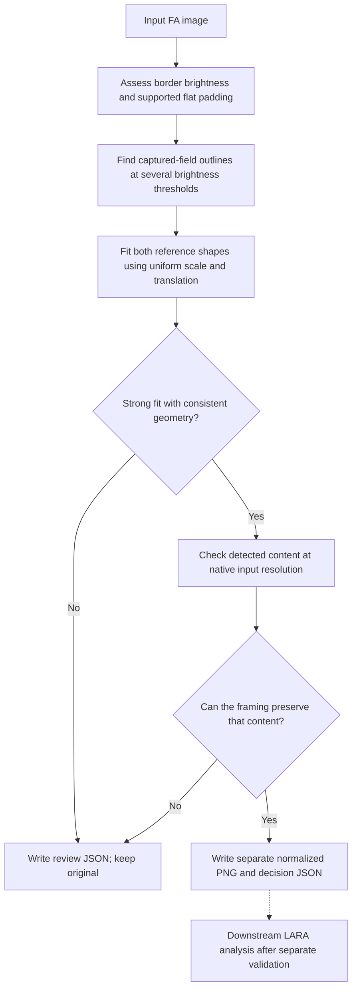

# LARA research code

This repository collects research tools for working with retinal fluorescein
angiography (FA) images. Each new pipeline has its own segment so its code,
requirements, tests and documentation can be used independently.

- **[FA framing normalization](pipelines/fa-normalization/README.md)** lives in
  `pipelines/fa-normalization/`. It estimates compatible digital shrinking and
  padding, preserves detected content, and sends uncertain cases for review.
- **[FA labeling and organization](docs/fa-labeling.md)** reads visit ZIPs and
  organizes original JPEGs with provisional eye, modality and phase labels. Its
  existing `fa_pipeline.py` entry point stays at the root for compatibility.

The labeling tool does not invoke the normalizer automatically. Select appropriate
FA images before running normalization; the normalizer does not classify modality.

## FA normalization: why it exists

An eye can occupy a smaller portion of an image because of digital shrinking or
extra background. That changes what a downstream model sees even when the
captured anatomy is the same. The normalizer estimates the captured field's
position and scale relative to two internal reference silhouettes. It considers
both silhouettes for every input, rather than choosing one from canvas dimensions.

A dim or obstructed image can also show only a small bright patch. The pipeline
therefore compares the broader field at several brightness thresholds and checks
content preservation before transforming anything. If that evidence is
insufficient, it records a review decision and leaves the original available.



The PNG has a 1024-pixel longest edge and preserves aspect ratio. The original is
never overwritten. The JSON records the crop, output transform, source/template
hashes and decision; a review decision produces no normalized PNG.

## Run the normalizer

Python 3.10+ and the three packages below are required. Tesseract is only needed
by the separate labeling tool. From the repository root:

```bash
python3 -m pip install -r pipelines/fa-normalization/requirements.txt
python3 pipelines/fa-normalization/fa_normalize.py /path/to/input.jpg \
  --output outputs/normalized.png \
  --report outputs/decision.json
```

Exit codes are `0` for an estimated framing, `2` for review, and `1` for an error.
Existing output/report files are refused. See the
[pipeline README](pipelines/fa-normalization/README.md) for methods, review reasons,
validation and limitations.

## Evidence and current scope

A fixed internal evaluation used 117 original images from 38 patients, generating
585 cases consisting of unchanged controls and known shrinking/padding variants.
The current method accepts 417 (71.3%) within the predefined geometry and spatial
signal-retention tolerances, and sends 168 (28.7%) for review. Review fell from
275/585 (47.0%) in the baseline: 107 fewer cases, or 38.9% fewer reviews. All
previously accepted cases remained accepted. Rectangular acceptance remains
limited at 11/45 cases.

These are correlated synthetic variants of internal images. External-device
transfer, physical retinal scale, clinical gradability and downstream zoning
performance have not been validated. This is an experimental research tool;
shape agreement does not establish anatomical equivalence.

## Layout and checks

```text
pipelines/fa-normalization/
  fa_normalize.py          # Normalization CLI and functions
  models/                 # Aggregate binary field silhouettes; no patient IDs
  requirements.txt
  tests/                  # Generated geometric fixtures; no patient images
  README.md
fa_pipeline.py            # Existing labeling and organization tool
fa_pipeline_settings.json
requirements.txt          # Labeling tool requirements
tests/                   # Existing labeling tests
docs/fa-labeling.md       # Labeling workflow and historical runs
samples/sample2/          # Existing historical baseline metadata
```

```bash
python3 -m unittest discover -s tests -p test_pipeline.py -v
python3 -m unittest discover -s pipelines/fa-normalization/tests -v
```

Local patient images, patient-level experiments, private review packets and
working research notes are excluded from the normalizer release. Existing
historical labeling metadata remains under `samples/sample2/`. The normalizer ships
only aggregate binary field templates with patient identifiers removed. Data
access permissions remain separate from access to this code.
