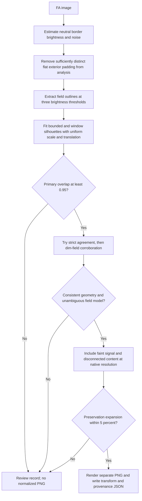

# FA digital-framing normalization

This pipeline estimates how a compatible FA image was digitally shrunk or padded,
then writes a separately framed image. It uses the captured field's overall
outline as evidence. It does not segment usable retina, restore hidden anatomy,
infer physical retinal scale, or correct camera projection.

The field is different from the brightest visible retinal patch: eyelids,
eyelashes and dim illumination can change that patch without changing the
captured view. The pipeline therefore checks field geometry at several
brightness thresholds and retains a review outcome when it cannot establish it.

## Running it

From the repository root, with Python 3.10+:

```bash
python3 -m pip install -r pipelines/fa-normalization/requirements.txt
python3 pipelines/fa-normalization/fa_normalize.py /path/to/input.jpg \
  --output /path/to/new_normalized.png \
  --report /path/to/new_decision.json
```

The script also works from another working directory when invoked by its absolute
path. Its templates are resolved beside the script in `models/`; no private
analysis folder or patient dataset is needed to run it. Tesseract is not required.
The caller selects FA images; this program does not verify image modality.

An accepted estimate writes a PNG with a 1024-pixel longest edge, preserving
aspect ratio. The JSON includes input size, estimated crop, uniform output
transform, shape score, agreement method, source/template hashes and scope.
The shape score measures overlap; it is not a probability of clinical correctness.

An uncertain estimate writes only JSON with `status: review`, a `review_code` and
an explanation. The original stays unchanged. Existing destinations are refused.
Exit status is `0` for an estimate, `2` for review and `1` for an error.

## How an image moves through the pipeline



The analysis preview has a maximum edge of 640 pixels. The detector fits the
largest connected signal component and fills internal holes to represent a field
envelope. That envelope includes obscured regions and is not a clinical retinal
mask. Both templates are tested regardless of the input canvas dimensions.

Strict corroboration requires a second threshold with overlap at least 0.95,
log-scale difference at most 0.025 and center differences at most 2% along each
axis. The fallback retains the 0.95 primary fit but permits a partly faded second
outline with overlap at least 0.85 and log-scale difference at most 0.05; center
checks remain unchanged. Two thresholds from the same image are a stability
check, not independent anatomical confirmation.

Before rendering, the crop expands to include native-resolution signal above the
estimated noise floor, including disconnected overlays. Expansion exceeding 5%
of the fitted width or height requires review. This conservative check can retain
artifacts as well as retina. Output sampling cannot restore detail lost through
shrinking, blur or obstruction.

## Review reasons

- `too_small`: the input cannot establish geometry at the supported analysis size.
- `insufficient_signal`: there is insufficient contrast for field estimation.
- `no_field_match`: no compatible field geometry could be fitted.
- `shape_overlap`: fitted shapes do not reach the primary overlap requirement.
- `threshold_agreement`: different brightness thresholds do not corroborate geometry.
- `model_ambiguity`: different field models give comparable fits.
- `no_preservation_signal`: the content-preservation check lacks reliable signal.
- `preservation_expansion`: preserving detected content would change framing too much.

A review outcome does not establish that an image is clinically unusable. It
means the program declined to transform it automatically.

## What has been tested

Field templates were derived from 63 internal training patients. A patient-balanced
majority silhouette produces each of the two binary templates; the square-style
training analysis excludes the bottom timer strip. The published template metadata
contains only version, scope and aggregate model information, with patient
identifiers and patient lists removed. See [models/README.md](models/README.md).

The fixed evaluation uses 117 originals from 38 other patients and five cases per
source: unchanged framing, centered shrinking, wide shifted padding, tall shifted
padding, and JPEG-compressed padding. The algorithm receives the input and fixed
templates; the original and known transform are used only to score recovery.

All accepted cases must meet three predefined checks: recovered width/height
error at most 5%, center displacement at most 2% of the source footprint's longest
edge, and spatial retention of at least 99.9% of source signal. Retention is the
worst result over original grayscale thresholds 1, 4 and 16, checking mapped pixel
centers against the crop. It does not measure clinical gradability or diagnostic
detail after resampling.

The baseline accepted 310/585 and reviewed 275/585. After development on training
patients and freezing the revision, acceptance rises to **417/585 (71.3%)** and
review falls to **168/585 (28.7%)**. All 417 meet the existing checks, and every
baseline acceptance is retained. That is 107 fewer reviews, an 18.3 percentage-point
decrease or a 38.9% relative reduction. The 95th-percentile size error among
accepted cases is 2.34%; center displacement is 0.31%.

The improvement is in square cases: **406/540** are accepted. Rectangular
acceptance remains **11/45** and does not improve. Additional training-patient
checks used 765 reserved cases, different simulated conditions and native-size
images; those checks are not pooled into the evaluation rate. Case variants share
sources and acquisition characteristics, so they are not independent clinical
trials. Private images and patient-level experiment records are not distributed.

## Limits and next step

Templates describe an internal export family. Familiar boundaries can conceal
different internal geometry: a diagnostic boundary-preserving warp can retain the
same field-match score despite changed anatomy. Unfamiliar fields, camera
projections, rotations, arbitrary overlays and illumination are not comprehensively
modeled. Even an accepted estimate does not certify a compatible anatomical view.

External FA evaluation after authorized access is the next research step.
External-device transfer, clinician-approved anatomical scale and downstream
zoning performance remain unvalidated. Preserve originals and use the review
records when deciding which images require further investigation.

## Tests

The tests generate geometric fixtures in memory and use temporary files. They
include recovery, dim-field handling, preservation, incompatible fields, invalid
inputs, overwrite refusal, template metadata and execution outside the repository.

```bash
python3 -m unittest discover -s pipelines/fa-normalization/tests -v
```
